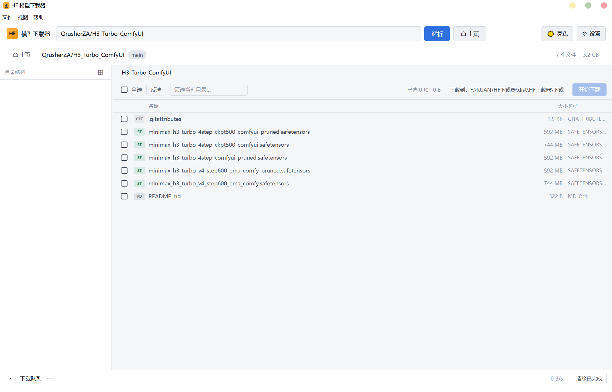

# HF 模型下载器

一个免安装的 Hugging Face 模型下载工具，用**资源管理器式的界面**浏览仓库文件树，勾选需要的文件下载。

专为国内网络环境设计：默认走 `hf-mirror.com` 镜像，同时支持自定义镜像地址。



## 为什么做这个

国内直连 `huggingface.co` 基本不可用（DNS 污染 + TLS 握手被重置）。命令行工具虽然能用镜像，但对"只想下某个项目里的 `unet`、`vae` 几个文件"这种需求不够直观——得记 `--include` 语法、反复 `--dry-run` 看清单。

这个工具把这件事变成：**粘贴地址 → 像资源管理器一样点选 → 下载**。

## 功能

### 浏览

- 粘贴 `https://huggingface.co/用户名/仓库名` 或直接输入 `用户名/仓库名`
- 左侧目录树 + 右侧文件列表，和 Windows 资源管理器一致
- 面包屑导航，点击任意层级跳转
- 显示文件大小、类型徽章
- 当前目录内关键词筛选

### 选择性下载

- **勾选单个文件**：点行或点复选框
- **勾选整个目录**：点目录复选框，递归选中所有子文件
- **三态显示**：`2/4` 表示 4 个文件里选了 2 个，父目录显示半选状态
- **全选 / 反选**：作用于当前可见项
- **实时统计**：工具栏显示「已选 N 项 · X GB」

### 下载

- **内置多线程分块下载器**，不依赖 aria2 等外部程序
- 单文件多连接（默认 8 分块），全局连接数上限（默认 16）
- **断点续传**：暂停、关程序重开都能接着下
- 下载中的文件用 `.hfdlpart` 后缀，完成后才改成正式文件名
- 网络错误自动重试（指数退避，最多 6 次）
- 小文件自动降级单连接（见下方技术说明）

### 其他

- **解析历史**：主页记录最近解析过的仓库，点击即达
- **下载历史**：记录下过哪些文件、存在哪里
- **复制镜像直链**：文件右键，把下载地址复制到剪贴板
- **深色 / 亮色主题**：一键切换，记住选择
- **可配置**：镜像站、下载目录、目录结构、并发数

## 使用

### 下载

从 [Releases](../../releases/latest) 下载 `HF-Downloader-vX.X.X-portable.zip`，解压到任意目录，双击 `HF下载器.exe`。

无需安装，不写注册表，不污染 `%APPDATA%`。所有配置和数据都在 exe 同级的 `_数据\` 目录，整个文件夹拷走就能带走全部设置。

### 支持的地址格式

```
https://huggingface.co/stabilityai/stable-diffusion-xl-base-1.0
https://hf-mirror.com/stabilityai/stable-diffusion-xl-base-1.0
stabilityai/stable-diffusion-xl-base-1.0
stabilityai/stable-diffusion-xl-base-1.0@v1.0        # 指定分支或 tag
https://huggingface.co/xxx/yyy/tree/main/vae         # 直接定位到子目录
```

### 典型场景：只下 SDXL 的 vae

SDXL 仓库有 57 个文件、71.6 GB，但你通常只需要其中几个：

1. 解析 `stabilityai/stable-diffusion-xl-base-1.0`
2. 左侧点 `vae` 目录
3. 右侧勾选 `diffusion_pytorch_model.safetensors`（334 MB）
4. 开始下载

工具栏会显示「已选 1 项 · 334.6 MB」，避免下错。

## 设置

| 项目 | 默认值 | 说明 |
|---|---|---|
| 下载目录 | exe 同级 `下载\` | 文件存到哪里 |
| 目录结构 | 带仓库名子目录 | 可切换为扁平化 |
| 镜像站 | `https://hf-mirror.com` | 可改成官方站或其他镜像 |
| 同时下载文件 | 3 | 并发文件数 |
| 单文件分块 | 8 | 单个文件开几个连接 |
| 总连接数 | 16 | 全局 socket 上限，弱网建议调低到 8 |

**目录结构两种模式：**

```
带仓库名：下载\stable-diffusion-xl-base-1.0\vae\model.safetensors
扁平化：  下载\stable-diffusion-xl-base-1.0\model.safetensors
```

## 从源码构建

### 环境要求

- Windows 10/11 x64
- Node.js 20+（或者用项目自带的便携 Node，见下）

### 开发

```bash
npm install
npm start
```

如果没有系统 Node，可以用便携版（项目根目录放一份 `node/`）：

```bash
./node/node.exe ./node/node_modules/npm/bin/npm-cli.js install
./node/node.exe scripts/dev.js
```

### 打包

```bash
node scripts/build-portable.js
```

产出：

```
dist/
├── HF下载器/                      绿色文件夹
└── HF下载器-免安装版-vX.X.X.zip   分发包
```

打包脚本会做几件事：

1. 版本号自动 +1（失败时自动回滚，不白吃版本号）
2. 调 electron-builder 的 `--dir` 目标（不用 portable，原因见下）
3. 组装成品目录
4. **自检**：检查文件完整性、asar 大小、以及 asar 内源码与磁盘源码的 sha1 是否一致（防止"改了源码忘重打包"）
5. 自写 ZIP 打包（必须写 UTF-8 标记，否则中文文件名换工具就乱码）
6. 清理中间产物

调试开关：

```bash
HF_SKIP_BUMP=1 node scripts/build-portable.js   # 跳过版本递增
HF_SKIP_PACK=1 node scripts/build-portable.js   # 复用已有 dist/win-unpacked
```

## 技术说明

### 为什么用 `target: "dir"` 而不是 `portable`

`portable` 目标产出单文件自解压 exe，运行时解压到 `%TEMP%` 随机目录，于是 `process.execPath` 指向临时目录，程序旁边的 `_数据\` 根本读不到——整个「数据放 exe 同级」的绿色方案会被破坏。

### 代码根目录与数据根目录分离

```js
// 打包后 CODE_ROOT 在 asar 内部（只读）
const CODE_ROOT = path.resolve(__dirname, '..');
// 打包后 APP_ROOT 是 exe 所在目录（可写）
const APP_ROOT = app.isPackaged ? path.dirname(process.execPath) : CODE_ROOT;
```

这两个必须分开，不能合并——asar 是只读的，往里写数据必然失败。

### Range 探测与降级

不是所有文件都支持 HTTP Range 分段请求：

| 文件类型 | 实测结果 |
|---|---|
| LFS 大文件（`.safetensors` 等） | `206`，支持分段 |
| 普通小文件（`.json` 等） | `200`，忽略 Range |

如果不做探测就分块下载，小文件会被整份写到偏移 0，**静默产出损坏文件**。所以下载前先发一个 `Range: bytes=0-0` 探测，不支持时降级为单连接流式下载。

### 并发控制

三层参数：

```
maxFiles        同时下载的文件数（3）
chunksPerFile   单文件内并发分块数（8）
maxConnections  全局 socket 上限（16，信号量）
```

第三层不能省：3 × 8 = 24 > 16。没有全局闸门时用户把 `maxFiles` 调高会让连接数失控，弱网下互相拖死。

### 断点续传

- 分块级 `done` 计数器，随写随更新
- 网络中断后从 `chunk.start + chunk.done` 继续，不重下整个分块
- 状态文件原子写入（`.tmp` → `rename`），断电最多丢 1 秒进度
- 用 `Content-Range` 的分母免费校验远端文件是否变过

### 网络栈

用 Electron 的 `net` 模块而不是 Node 的 `https`：

- 自动走 Windows 系统代理（Clash/v2rayN 只设系统代理，Node 的 `https` 看不见）
- 用 Windows 证书库（公司 MITM 代理的根证书 Node 不认）
- 自带 HTTP/2

## 项目结构

```
├── shell/                    主进程
│   ├── main.js               入口：单实例、窗口、菜单
│   ├── paths.js              双根常量 + userData 重定向
│   ├── ipc.js                所有 IPC 通道
│   ├── settings.js           设置读写
│   ├── history.js            下载历史
│   ├── parse-history.js      解析历史
│   ├── net/
│   │   ├── client.js         Electron net 封装
│   │   ├── errors.js         错误分类与重试判定
│   │   └── hf-api.js         解析输入 / 文件树 / 仓库信息
│   ├── download/
│   │   ├── manager.js        队列、并发、进度节流
│   │   ├── task.js           任务状态机
│   │   ├── chunk.js          分块下载（核心）
│   │   ├── plan.js           分块规划 / Range 探测
│   │   ├── state.js          断点状态持久化
│   │   ├── semaphore.js      全局连接数闸门
│   │   └── meter.js          速度测量
│   └── util/                 日志、格式化、路径安全
├── renderer/                 渲染进程
│   ├── index.html
│   ├── styles/               主题、布局、组件
│   └── js/                   树模型、树视图、列表视图、队列视图
├── preload.js                contextBridge 白名单
├── scripts/
│   ├── build-portable.js     5 阶段打包
│   ├── make-icon.js          零依赖生成 ico
│   └── dev.js                开发态启动器
└── config/electron-builder.json
```

## 已知限制

- **gated 模型**（如 Llama 系列、FLUX）需要先在 Hugging Face 网站同意协议。镜像站不保证能透传授权，这类模型可能无法下载。
- **镜像站冷门模型**：hf-mirror 是按需缓存，刚发布或冷门的仓库第一次请求可能较慢。
- **无代码签名**：首次运行 Windows SmartScreen 可能提示，选择「仍要运行」即可。

## 相关

- [hf-mirror.com](https://hf-mirror.com) — 国内可用的 Hugging Face 镜像站
- [huggingface_hub](https://github.com/huggingface/huggingface_hub) — 官方 Python 客户端

## License

[MIT](LICENSE)
